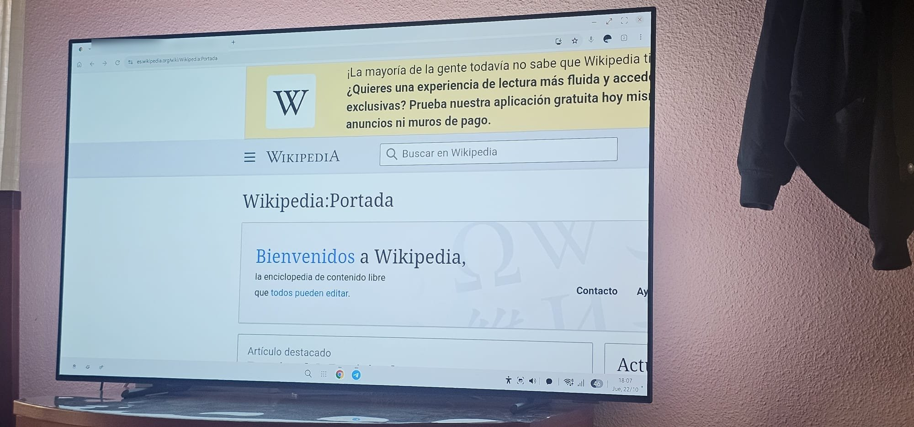
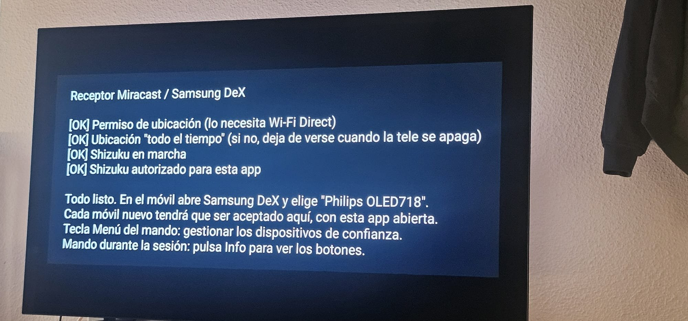

# Receptor DeX

[**English**](README.md) · [Español](README.es.md)

Miracast / Wi-Fi Display **receiver (sink) for Android TV** that lets you use **wireless Samsung DeX**
(tested with a Galaxy S23 Ultra). H.264 1080p video and LPCM audio.

> **Version 1.0, experimental.** Only one phone and one TV tested (Philips 55OLED718/12, Android 14).
> Detailed status: [REQUIREMENTS.md](REQUIREMENTS.md) · architecture: [SPEC.md](SPEC.md) · licenses: [NOTICE.md](NOTICE.md)
> (SPEC and REQUIREMENTS are in Spanish for now; a machine translation is good enough to follow them.)

## Screenshots

| Samsung DeX on the TV (Galaxy S23 Ultra → Philips OLED718) | App status screen on the TV |
|---|---|
|  |  |

## User guide

**Requirements:** an Android TV with network ADB (port 5555) enabled, and a Samsung phone with DeX.

1. Install the APK from [Releases](../../releases): `adb connect TV_IP:5555` then `adb install -r ReceptorDeX-v1.0.apk`.
2. Open **Receptor DeX** and grant the permissions (location → "Allow all the time", in Settings). The first
   time, accept the ADB key prompt on the TV ("Always allow from this computer"; focus starts on "Cancel",
   move it to "Allow"). The app starts Shizuku by itself.
3. On the phone: quick settings → **DeX** → pick the TV.
4. On the TV, accept the phone: **Accept / Always accept / Reject**. Trusted phones are remembered;
   the **Menu** key forgets them.
5. To stop, disconnect from DeX on the phone. The app keeps advertising in the background.

**TV remote (experimental, the phone may ignore it):**

| Button | Action |
|---|---|
| Arrows | Move pointer |
| OK | Click |
| Back (hold) | Back (Esc) |
| Green / Yellow | Scroll up / down |
| Red / Blue | Zoom − / + |

**If the connection fails:** close DeX on the phone, toggle its Wi-Fi off and on, and retry.

## Known limitations

~1 s cursor latency; remote control unverified except the Space key; boot start, TEARDOWN/PAUSE/PLAY and other
phones untested; the UIBC input channel is unencrypted (use it on a home network). `targetSdk 30` is
deliberate (pre-Android-13 P2P permission path), so it is not suitable for Google Play.

## Build

`./gradlew assembleRelease` (JDK 17, Android SDK). The release APK is signed with the debug key; sign it with your own to distribute it.

## Contributing

See [CONTRIBUTING.md](CONTRIBUTING.md) and the issues labelled `help wanted`. Test reports with other
phones/TVs are very valuable.

## License

Apache-2.0. See [LICENSE](LICENSE) and [NOTICE.md](NOTICE.md).
